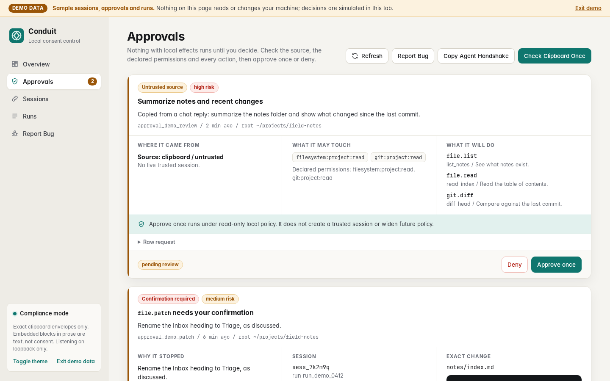
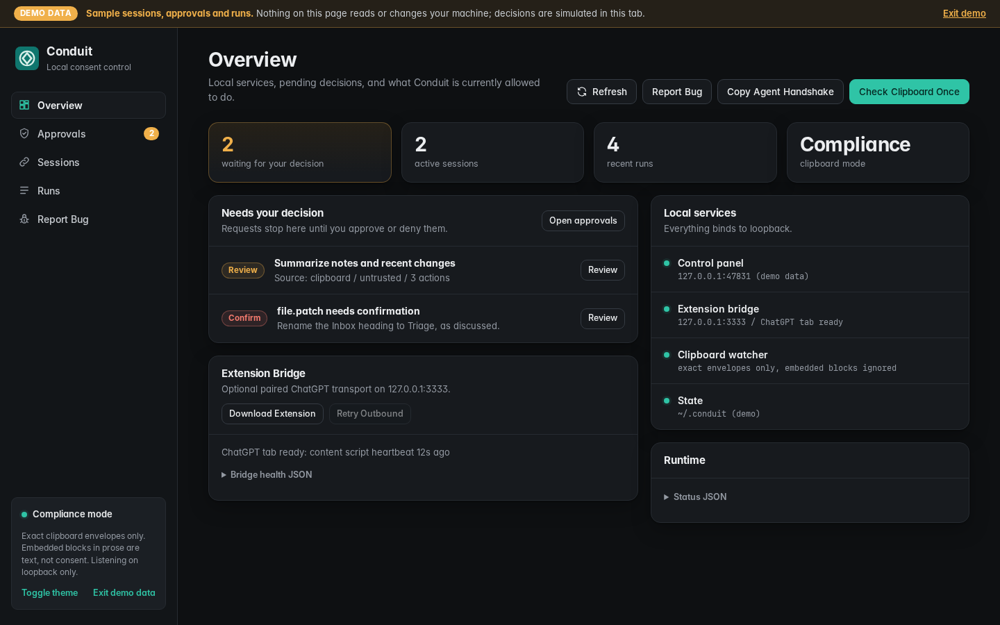
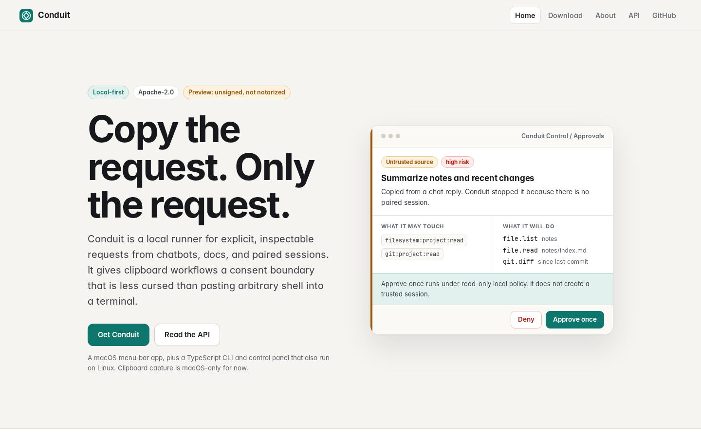
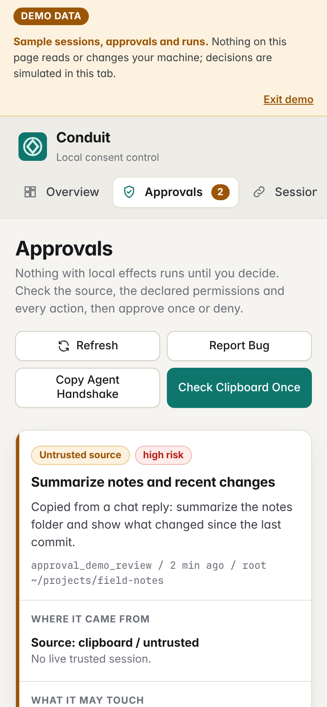

# Conduit

**Better than `curl | sh`. Arbitrary code execution for everyone: one click,
no installer, no terminal.**

Conduit is arbitrary code execution on your machine. That is the point.
Running real code from a source you decide to trust should not stay a
power-user skill. Conduit's aim is one click: no installer, no terminal.

The trust model is built: you know who is asking. Sources you trust (a paired
session) run quietly. An unknown source asks you once. A request cannot be
replayed; every call carries a one-shot nonce. The macOS menu-bar app
supervises the services it starts and stops their process trees when you quit.

Conduit is not a safety product, not a sandbox, not a ChatGPT wrapper and not
an auth bypass. It is a local runtime plus transports, built by Owl + Kestrel.

Direction, not built yet: a one-click "Start a server" flow, where a
multiplayer game page offers a button that runs the game's server code as a
background process on your machine with no separate download or install; an
optional "run clean" mode; and a reusable package that can stay behind and age
off on its own. Cleanup is the job of whoever writes the code that runs, as
with any well-behaved program.

> **Status: preview.** v0.0.1 is a closed-alpha build. The macOS app is
> **not code-signed or notarized by Apple**, so macOS will warn on first
> launch. Treat every capability boundary as load-bearing.
> Licensed under [Apache-2.0](LICENSE).

| Approvals (demo data) | Overview, dark (demo data) |
| --- | --- |
|  |  |

| Website | Phone |
| --- | --- |
|  |  |

More sizes and both color schemes live in [docs/screenshots](docs/screenshots).
Every control-panel screenshot is **demo data** (see below), not a real machine.

## What is in the box

- **macOS menu-bar app** (Swift) that supervises the local services and stays
  quiet while trusted work runs. Its status icon shows idle, running, needs you,
  paused or error; its popover lists asks (Allow once / Deny / Details), a
  **Pause all** switch and **Stop all**. Notifications carry Deny and Review,
  plus Allow once for single-file edits whose path is in the notification.
  ⌃⌥C opens the popover on the oldest ask. Service controls, updates and logs
  are in the native **Settings…** window. Quitting stops everything.
- **Control panel** at `http://127.0.0.1:47831` for sessions, starter
  envelopes, clipboard checks, agent handshakes, approvals, runs and redacted
  bug reports.
- **Clipboard daemon** that only acts on an *exact* Conduit envelope.
- **Browser-extension bridge** on `127.0.0.1:3333` for paired ChatGPT agent
  loops (optional).
- **TypeScript CLI/runtime** with policy-routed local tools
  (`file.read`, `file.list`, `git.status`, `git.diff`, `file.write`,
  `file.patch`, `shell.run`).
- **Static website** in `website/`.

## Quickstart

You need Node 20 or newer and git.

```sh
git clone https://github.com/owl-and-kestrel/conduit
cd conduit
npm ci
npm test
```

`npm ci` pulls one dev-only package, `@owl-kestrel/hatch-contracts`, from the
Owl + Kestrel registry configured in `.npmrc`. It needs no login.
`npm ci --omit=dev` skips it. The Linux and Windows preview packages ship a
`package.json` without devDependencies, so their `npm install --omit=dev`
needs only the public npm registry.

### Works on Linux and macOS

| Command | What it does |
| --- | --- |
| `npm run app` | Starts the control panel on `http://127.0.0.1:47831`. |
| open `http://127.0.0.1:47831/?demo=1` | The same panel with **demo data**: sample sessions, approvals and runs. |
| `npm run spike` | Runs the fake transport end to end against `fixtures/fake-project`. |
| `npm run doctor` | Checks the local runtime environment. |
| `npm run conduit -- session create --label Demo --root fixtures/fake-project` | Pairs a session (see `session list`, `session revoke`). |
| `npm run conduit -- pause` / `resume` / `status` | Pauses or resumes all execution (`--session <id>` for one session); `stop-all` also revokes every session. Add `--local` when Control is not running. |
| `npm run conduit -- approvals list` | Lists pending approvals; `approvals show|approve|deny <id>` decide them through the same API as the panel. `runs list` lists runs and `runs result <id>` prints one result. |
| `npm run conduit -- app status` | Shows the running Control service; `session handshake` prints an agent handshake, `url open <link>` submits a `conduit://` link and `diagnostics` prints the redacted bug-report bundle, all through the same API as the panel and menu bar. |
| `npm run listen` | Starts the extension bridge listener on `127.0.0.1:3333`. |
| `npm run site:dev` | Serves `website/` on `http://127.0.0.1:47832`. |
| `npm run build` | Type-checks and compiles to `dist/` (`node dist/src/cli/index.js --help`). |
| `npm run linux:package` | Builds the Linux preview tarball (launchers, no tray app yet). |
| `npm run screenshots` | Regenerates `docs/screenshots` (run `npx playwright install chromium` once). |

### macOS only

| Command | What it does |
| --- | --- |
| `npm run macos:run` | Builds and launches `dist/macos/Conduit.app` (Swift toolchain required). |
| `npm run macos:package` | Builds an unsigned preview `Conduit.dmg`, checksum, appcast and release notes. |
| `npm run conduit -- daemon start` | Watches the clipboard for exact envelopes. Uses `pbpaste`/`pbcopy`. |
| **Check Clipboard Once** / **Copy Agent Handshake** | Read and write the system clipboard. On Linux the handshake is shown for a manual copy instead. |
| `npm run extension:package` | Zips the browser extension (needs `/usr/bin/zip`). |

The menu-bar app starts three supervised children: the control panel
(`:47831`), the extension listener (`:3333`) and the clipboard daemon. They
have a deadman switch and exit if the parent app disappears.

### Demo data mode

Open the control panel with `?demo=1`, or choose **View demo data** in the
sidebar. A banner labels the page. Everything is in-memory sample data, so
approve and deny decisions are simulated in the tab. Demo mode never calls the
local API, never reads or writes the clipboard and never executes anything.
Without `?demo=1` the panel talks only to your real local services.

## How consent works

**Exact envelopes.** The clipboard daemon trims whitespace and acts only if the
entire clipboard is one valid Conduit envelope: a fenced `conduit` or
`conduit-json` block, or one raw JSON request object. A README, chat reply or
web page that merely *contains* a block is text, not consent.

**Reviews for untrusted requests.** An exact envelope without a live paired
session is never executed silently. It becomes a `conduit.review` approval
showing the claimed source, declared permissions, requested capabilities and
actions. **Approve once** runs those actions once under a narrow read-only
policy rooted at the project. It does not create a trusted session or widen
future policy.

**Sessions and nonces.** Trusted execution needs a paired session with a
permission profile, allowed roots and a one-shot nonce. Every successful result
returns `nextNonce`. Revoking a session kills its nonce.

**Profiles.**

- `read-only`: reads, listings and git inspection run; writes, patches and
  shell are denied.
- `edit-with-confirmation`: reads run; `file.write` and `file.patch` wait for
  approval; shell is denied.
- `shell-manual`: reads run; writes, patches and every `shell.run` wait for
  approval.

Confirmation-required actions create one shared approval record. The terminal,
the control panel, the menu bar and the CLI (`conduit approvals`) are all
approval surfaces for it, and the record stores where the decision came from
(`decidedBy`). Every approval, including an untrusted-request review, expires
after 10 minutes; **timeout means deny**, applied whenever the record is read,
so a stale ask can never be approved late. Hard denials include project-root
sandbox violations and secret-looking filenames.

**Allow for this chat.** Next to Allow once, a shell command or single-file
write from a paired chat can be allowed for this chat (web panel button, ⌘Return
in the popover, `conduit approvals approve <id> --for-this-chat`, or
`remember: "session"` on the approve call). The same exact command, or a write
to the same path, then runs without asking in that chat only. It is never
remembered for another chat, ends when the chat is revoked or expires, and is
gone after Conduit restarts: it is kept only in the memory of the process that
asked. It only skips an ask; anything policy denies stays denied. Patches and
untrusted requests can only be allowed once.

**Return on shell commands.** In the popover and the web panel, Return on a
shell command whose details are closed opens the details; Return again allows
it. Clicking is not affected. The setting **Return approves shell commands
without opening details** (off by default) turns this off: the Settings window,
the panel's Approvals view, `conduit settings set
--return-approves-shell-without-details on|off`, or `POST /api/settings`.

**Pause.** `conduit pause` (or `POST /api/control/pause`) sets a flag in the
state root that every execution path checks before any tool runs, including
trusted auto-runs and `--yes`. While paused nothing runs, no approval is asked,
no nonce is consumed, and the agent receives a `paused` repair envelope; a tool
already running finishes, the rest of its batch does not start. The flag
survives restarts, and an unreadable flag counts as paused. `--session <id>`
pauses one session. `conduit stop-all` pauses and revokes every live session.
Pause and resume exist only on the Origin-guarded control panel, never on the
extension bridge. In the menu bar, **Pause all** (⌘P in the popover) calls the
same endpoints, and **Stop all** calls `stop-all` and then also stops the
services the menu bar launched, including any tool run under them; if Control
does not answer it writes the pause with `conduit stop-all --local`. Menu-bar
and notification decisions are recorded as `decidedBy: menubar` and
`notification`.

**Local-only API.** Every Conduit service binds `127.0.0.1`. The control panel refuses
to bind anything else, answers only loopback `Host` headers (DNS rebinding) and
rejects state-changing requests from other origins. The menu-bar app, curl and
the tests send no `Origin` and are unaffected. The extension bridge (`:3333`)
answers only `127.0.0.1`/`localhost` on its own port and only the Conduit
extension: the extension pairs from its `chrome-extension://` origin, which web
pages cannot claim, and every bridge call then carries the per-process pairing
token. Web origins get 403, preflights included; the control panel may read
`/health` and request a retry. See [extension/README.md](extension/README.md#pairing).

A request looks like this:

```conduit
{
  "schema": "conduit.request.v1",
  "source": { "kind": "clipboard", "trust": "untrusted" },
  "permissions": [{ "kind": "filesystem", "scope": "project", "access": "read" }],
  "sessionId": "sess_...",
  "nonce": "call_...",
  "list": ".",
  "reason": "List the project root.",
  "risk": "low"
}
```

Compact shortcuts (`read`, `list`, `diff`, `status`, `write`, `patch`,
`shell`, `help`, `about`), the small-model dialect (`v`, `session`, `n`, `do`,
`why`), the agent handshake and the extension loop are documented in
[docs/agent-loop.md](docs/agent-loop.md).

**See it.** `npm run demo:consent` runs the consent loop end to end on the real
CLI, in an isolated temp state dir with a file-backed clipboard. A trusted,
nonced envelope runs with zero asks. The same envelope without its nonce
becomes exactly one review ask, which the demo denies, and nothing runs. A
replayed nonce is refused. Results:
[docs/results/consent-loop-demo.md](docs/results/consent-loop-demo.md).

## Health and logs

```sh
curl http://127.0.0.1:47831/api/status
curl http://127.0.0.1:3333/health        # extension bridge, when running
```

On macOS, service logs live in `~/Library/Logs/Conduit/`. Session, approval
and run state lives in `~/.conduit` (override with `CONDUIT_STATE_DIR`).
**Report Bug** in the control panel previews a redacted diagnostic bundle that
excludes clipboard contents, request payloads, file contents, nonces, API keys
and environment variables.

## Project status

Working today:

- TypeScript CLI/runtime, policy engine, session/nonce store, local tools and
  run logs
- exact-envelope clipboard daemon (macOS clipboard)
- control panel with approvals, review records and execution lifecycle,
  demo data mode and redacted diagnostics
- macOS menu-bar app with supervised services and approval notifications
- unsigned macOS preview DMG, with O+K-signed update manifests verified before
  an in-place update
- Chrome/Brave unpacked extension bridge with paired-session nonce enforcement
- deterministic agent-loop transcript harness and a protocol model eval harness
- Windows and Linux preview packages (launchers and metadata)

Not production-ready yet:

- Apple code signing and notarization
- clipboard support on Linux and Windows (the daemon uses `pbpaste`/`pbcopy`)
- native Windows and Linux tray apps
- a Chrome Web Store listing for the extension
- sandboxed dry runs and trust analysis for higher-risk requests
- robust tab discard/throttle detection and live ChatGPT extension tests

See [NEXT_STEPS.md](NEXT_STEPS.md) for the buildout log and next gates.

## Release notes for maintainers

`npm run macos:package` writes `dist/macos/Conduit.dmg`, its `.sha256`,
`conduit-appcast.json` and `RELEASE_NOTES.txt`. Point release metadata at
hosted artifacts with:

```sh
CONDUIT_RELEASE_BASE_URL="https://github.com/owl-and-kestrel/conduit/releases/download/v0.0.1" npm run macos:package
```

Launch builds wrap the appcast in an `ok.signed-manifest.v1` envelope when
`OK_RELEASE_PRIVATE_KEY_PEM` and `OK_RELEASE_SIGNER` (the O+K
`sign-manifest.mjs`) are set. The menu-bar app pins the O+K publisher
identity, verifies the signed manifest and the DMG SHA-256, then installs in
place. It refuses to replace the app from an unsigned manifest. Operational
details are in [docs/launch-handoff.md](docs/launch-handoff.md).

The opt-in protocol model eval (`npm run eval:protocol`) needs
`GOOGLE_AI_STUDIO_API_KEY` in the environment and never runs in `npm test`.

## More docs

- [spec.md](spec.md): product and security contract
- [docs/agent-loop.md](docs/agent-loop.md): handshake, request dialects and the
  extension loop
- [extension/README.md](extension/README.md): extension install, behavior and
  telemetry
- [platforms/desktop-shell-contract.md](platforms/desktop-shell-contract.md):
  what every desktop shell must provide
- [implementation.md](implementation.md): the original v0 build guide (history)
- [docs/auth-troubleshooting.md](docs/auth-troubleshooting.md),
  [docs/extension-transport-plan.md](docs/extension-transport-plan.md)

## License

Apache-2.0. See [LICENSE](LICENSE) and [NOTICE](NOTICE).

Keep the loop small until it is boring.
